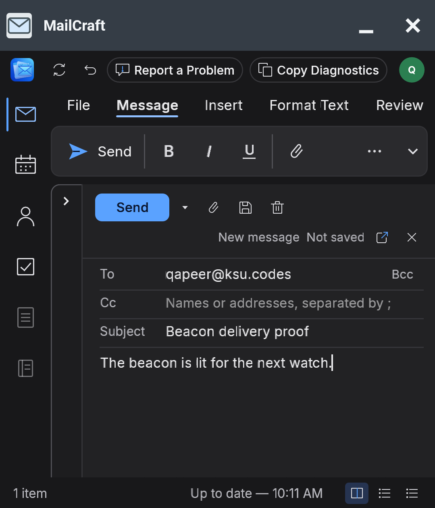
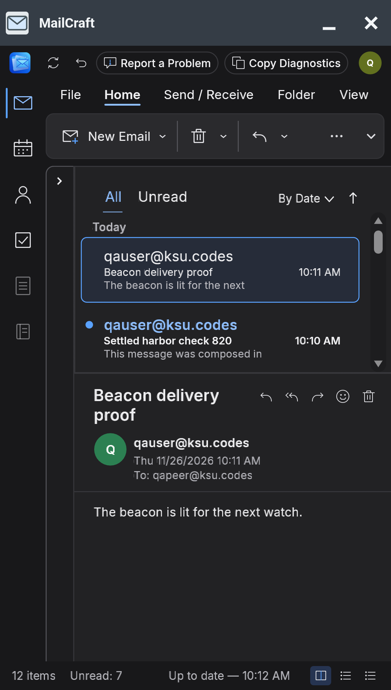
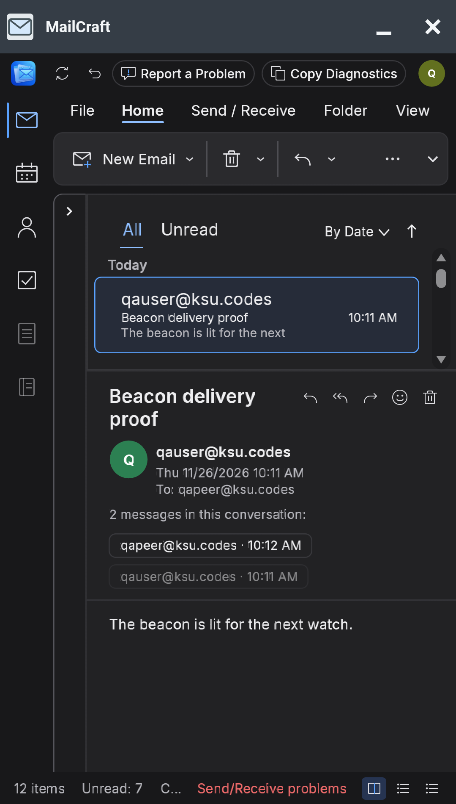

# MailCraft in WebOS

Open **Apps → Office → MailCraft** from a signed-in WebOS session with mailbox access. The mounted app uses the session's approved JMAP mailbox.

## Galaxy S10+ workflow

1. Open MailCraft and select the synthetic **Lantern delivery** message. Check its full body in the reader. Refresh WebOS while MailCraft is open and confirm the inbox returns automatically.
2. From an account with local send permission, open **New Email**. Enter the second fixture address, the subject **Beacon delivery proof** and a short body. Keep the Android keyboard open for all three fields. Use **Send**.
3. In the second account, open the delivered message and check the same subject and body. Open **Reply** to check the recipient and original subject. A receive-only account can draft a reply. Its attempted submission must fail, and the sender's inbox must stay free of that reply.
4. Minimize MailCraft. The WebOS app bar should return.

The S10+ ran Chrome 158.0.8127.92 at 411 CSS pixels in preview `efb980f32987`. Chromium 158.0.8127.36 at 820 and 1300 CSS pixels also passed inbox sign-in, refresh, reading, composition and local delivery. Stalwart ran with two disposable mailboxes and a loopback-only network. It delivered the authorized messages, rejected a receive-only submission and denied access to the other account's inbox.

The WebGL renderer now uses the adapter's supported texture dimension. The phone's browser viewport remained about 480 CSS pixels high during composition, leaving the recipient, subject, body and Send action reachable above the keyboard. The phone layout keeps delivery problems visible in the footer.

Session reconnect, message reading, and composition cover three of the ten workflow groups. Desktop coverage remains partial. Rapid scripted focus changes in headless Chromium sometimes carried subject text into the body. Repeating the checks with each field settled gave exact headers and bodies at both widths. Follow-up groups cover drafts and archive workflows, attachment import and export, advanced inbox organization, rules and signatures, calendars, contacts and tasks, and multiple-account administration.

## Build

[Browser packaging](../../packaging/web/README.md) describes the upstream web bundle. The WebOS deployment wraps the bundle with its same-origin JMAP bridge.
